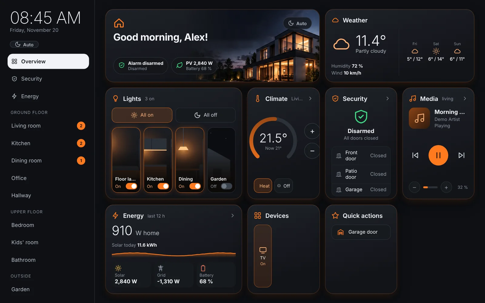
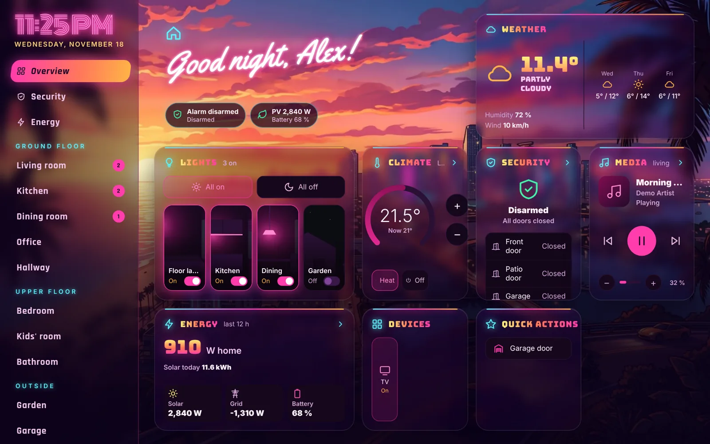
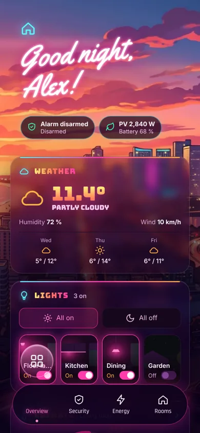
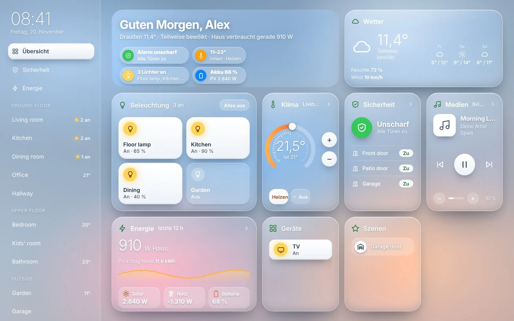
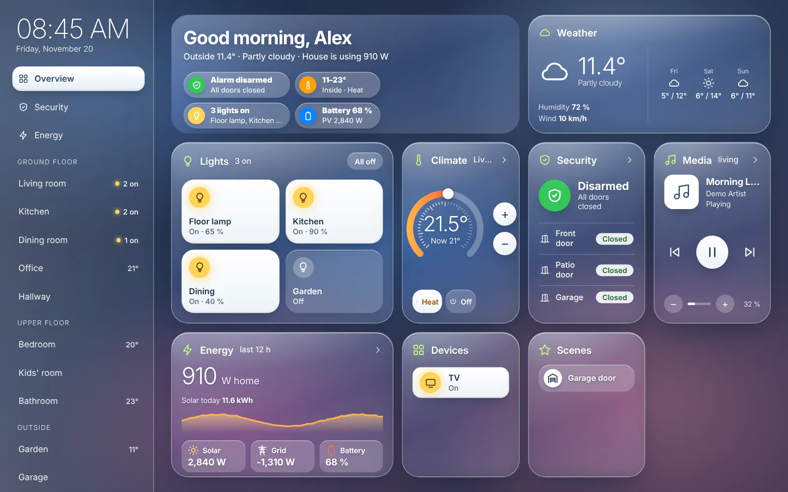
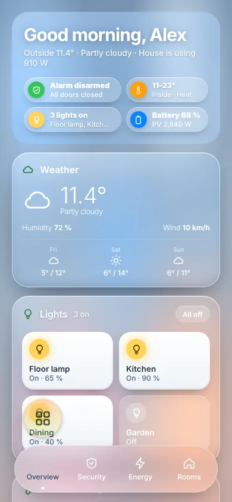
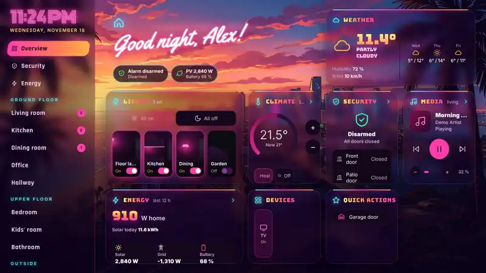
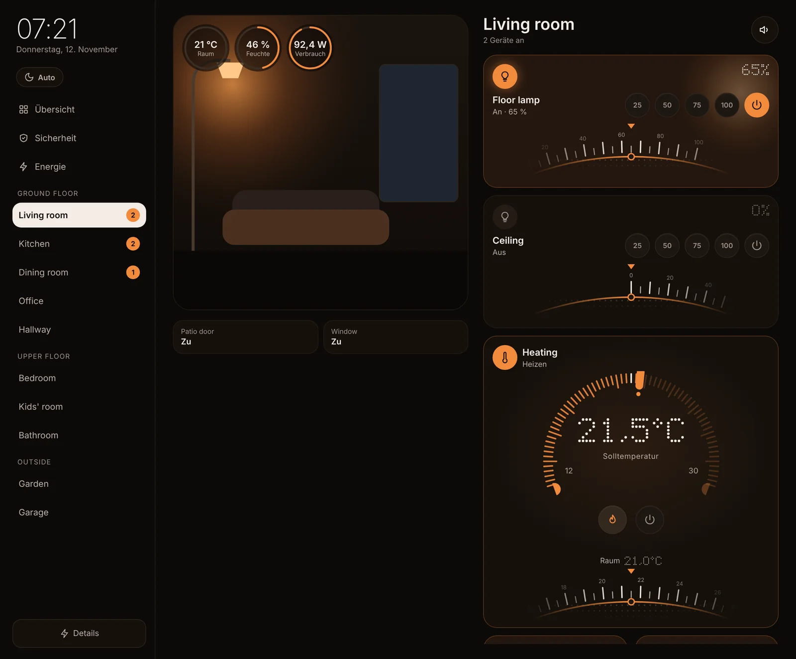
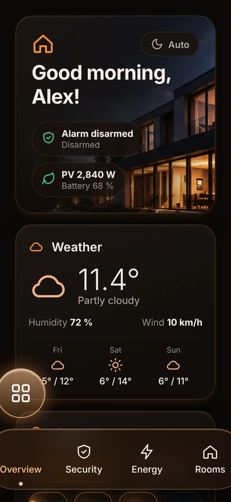

# Home Live Card

A full-screen dashboard card for Home Assistant: house picture with live figures,
rooms with photo backgrounds, a thermostat dial with a curved scale, light rulers,
energy and security views. Built for wall tablets and phones.

> Status: early preview (v0.7). English and German; the language follows your Home Assistant profile.


Second colour scheme, `palette: graphite`:



`palette: neon` – a coastal city at sunset behind glass cards, neon headings and chrome numbers.
It always uses the night look. The upper part of the overview stays free so the picture shows.

| Neon, tablet | Neon, phone |
|---|---|
|  |  |

New in 0.7: `palette: glass` – light liquid-glass cards on a soft pastel wallpaper, white type and
the Inter font (Apple-like). It switches to a dusk wallpaper at night by itself.

| Glass, day | Glass, night | Glass, phone |
|---|---|---|
|  |  |  |

New in 0.6: background animations, chosen per colour scheme with `animation`
(off by default):

| Value | Colour schemes | What moves |
|---|---|---|
| `city` | neon | car lights on the roads, glittering sea, windows and neon signs in the skyline, a boat |
| `weather` | all | rain, snow, fog, clouds or stars, following your weather entity (`overview.weather`) |
| `daycycle` | amber, graphite, glass | sky colour, sun and stars following `sun.sun` |



The animations stop when the device asks for reduced motion. `background_image` sets your own picture
(any URL, for example `/local/my-picture.webp`); `background_image: synthwave` brings back the
neon grid scene of 0.5, `none` shows no picture.

| Room with light ruler and thermostat dial | Phone |
|---|---|
|  |  |

All screenshots use the invented demo home in [`demo/`](demo/) (open `demo/index.html` in a browser).

## Install

**Marketplace (Home Assistant 2026.11+) or HACS:** search for *Home Live Card* and install it.

**Manual:** copy `dist/home-live-card.js` to `/config/www/` and add it as a dashboard
resource (type *JavaScript module*, URL `/local/home-live-card.js`).

## Use

Create a view of type **Panel** and add the card. It starts with one room per Home Assistant
area (lights, switches, covers, climate, media players, door and window contacts). Rooms,
devices, sensors and the energy block (including hot water and the largest consumers) can then
be edited in the visual editor; the overview, security and waste calendar blocks are set in the
code editor.

Minimal configuration:

```yaml
type: custom:home-live-card
rooms:
  - id: living
    name: Living room
    devices:
      - entity: light.living_room
        name: Ceiling
```

All options: [examples/full.yaml](examples/full.yaml).

## Pictures

The card works without pictures (rooms get a drawn scene). To use your own:

| What | Path | Size |
|---|---|---|
| House, day / night | `overview.hero_day`, `overview.hero_night` | 2000 px wide or more |
| Room, day / night | `/local/home-live/rooms/<room id>_day.webp`, `_night.webp` (folder set by `image_path`) | 1600 × 900 or more |

No pictures are shipped inside the card file. The neon city picture is loaded from this repository
through the jsDelivr CDN (see Privacy); it was created with Google Gemini for this card.

## Privacy

By default the card loads the Manrope font from Google Fonts (with `palette: neon` also
Bungee, Monoton, Rajdhani and Yellowtail, with `palette: glass` Inter, all under the SIL Open Font License). Set
`load_font: false` to use the system fonts instead and make no request to Google.

With `palette: neon` the background picture is loaded from `cdn.jsdelivr.net`. To avoid that,
download `docs/bg/neon-city.webp`, put it into `/config/www/` and set
`background_image: /local/neon-city.webp` (the `city` animation then only zooms slowly, because the
light positions belong to the original picture), or use `background_image: synthwave`.

## License

MIT
