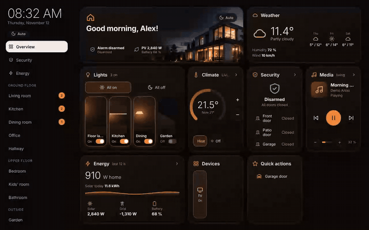
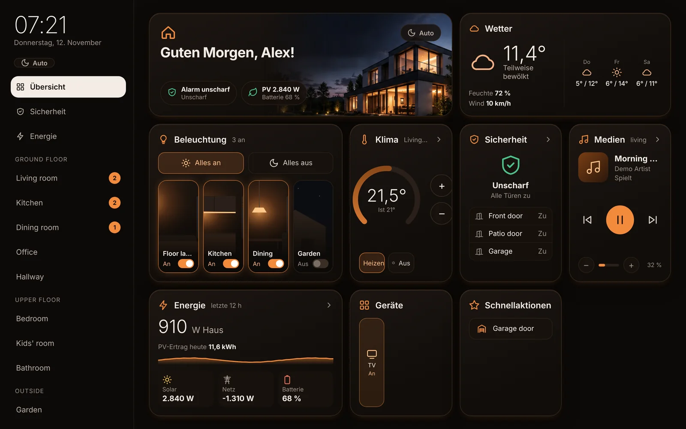

# Home Live Card

A full-screen dashboard card for Home Assistant: house picture with live figures,
rooms with photo backgrounds, a thermostat dial with a curved scale, light rulers,
energy and security views. Built for wall tablets and phones.

> Status: early preview (v0.4). English and German; the language follows your Home Assistant profile.





Second colour scheme, `palette: graphite`:


| Room with light ruler and thermostat dial | Phone |
|---|---|
|  |  |

All screenshots use the invented demo home in [`demo/`](demo/) (open `demo/index.html` in a browser).

## Install

**Marketplace (Home Assistant 2026.11+):** Settings → Marketplace → add this repository
by link, then install *Home Live Card*.

**Manual:** copy `dist/home-live-card.js` to `/config/www/` and add it as a dashboard
resource (type *JavaScript module*, URL `/local/home-live-card.js`).

## Use

Create a view of type **Panel** and add the card. It starts with one room per Home Assistant
area (lights, switches, covers, climate, media players, door and window contacts). Rooms,
devices, sensors and the energy block (including hot water and the largest consumers) can then
be edited in the visual editor; the overview, security and waste calendar blocks are set in the
code editor.

Minimal configuration:

```yaml
type: custom:home-live-card
rooms:
  - id: living
    name: Living room
    devices:
      - entity: light.living_room
        name: Ceiling
```

All options: [examples/full.yaml](examples/full.yaml).

## Pictures

The card works without pictures (rooms get a drawn scene). To use your own:

| What | Path | Size |
|---|---|---|
| House, day / night | `overview.hero_day`, `overview.hero_night` | 2000 px wide or more |
| Room, day / night | `/local/home-live/rooms/<room id>_day.webp`, `_night.webp` (folder set by `image_path`) | 1600 × 900 or more |

No pictures are shipped with the card.

## Privacy

By default the card loads the Manrope font from Google Fonts. Set `load_font: false` to use
the system font instead and make no request to Google.

## License

MIT
